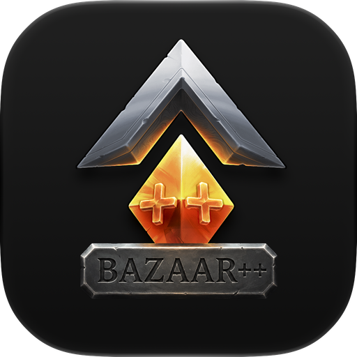

<div align="center">



# BazaarPlusPlus

**因热爱而生** · 为 [《The Bazaar》](https://www.playthebazaar.com) 打造的游戏内模组：Windows、macOS 与 Android

[English](README_en.md) · [官网](https://bazaarplusplus.com) · [下载](https://bazaarplusplus.com/download) · [使用教程](https://bazaarplusplus.com/tutorial) · [Release Notes](https://github.com/BazaarPlusPlus/BazaarPlusPlus/releases) · [Ko-fi](https://ko-fi.com/cauyxy)

[](https://bazaarplusplus.com)
[](LICENSE)
[](https://bazaarplusplus.com/download)

</div>

---

BazaarPlusPlus 不改变游戏平衡，只做信息增强与记录：卡牌图鉴、十胜阵容推荐、对局历史与战斗回放、附魔 / 升级预览、战斗状态栏等。

> [!NOTE]
> 项目代码主要由 [Codex](https://openai.com/codex) 主导，并由 [Claude Code](https://claude.com/product/claude-code) 协作完成。

## 下载与安装

到 [下载页](https://bazaarplusplus.com/download) 获取对应平台的安装包，详细步骤见 [使用教程](https://bazaarplusplus.com/tutorial)。

- **Windows / macOS**：关闭游戏后运行安装器，再启动一次游戏；主菜单出现「卡牌图鉴」按钮即安装成功。安装器同时负责修复、卸载和更新。
- **Android（实验版）**：先安装官方版 The Bazaar，再安装 BazaarPlusPlus 的 APK（arm64，Android 11+），从 BazaarPlusPlus 启动游戏。问题反馈：QQ 群 1083470305。

## 功能

桌面版包括 Windows 和 macOS。✅ 支持　◐ 部分支持　— 不支持

| 功能                   | 桌面版 |          Android           |
| ---------------------- | :----: | :------------------------: |
| 卡牌图鉴与十胜阵容推荐 |   ✅   |             ✅             |
| 对局历史、收藏与笔记   |   ✅   |             ✅             |
| 战斗回放与幽灵对战     |   ✅   |             ✅             |
| 战斗状态栏与速度控制   |   ✅   |             ✅             |
| 附魔、升级与详细预览   |   ✅   |     ◐ 操作与内容有差异     |
| 回放录像               |   ✅   |             —              |
| 终局自动截图           |   ✅   | ◐ 仅在开启 BazaarDB 上传时 |
| OBS 直播叠层           |   ✅   |             —              |

各平台会在不处于对局时后台上传对局与回放数据，用于幽灵对战和官网的[英雄统计](https://bazaarplusplus.com/heroes)。去掉账号和昵称后的对战数据可能会保存更久，用于分析和研究。若玩家主动绑定了 BPP 账号，还会为该账号长期保存不含对手账号与昵称的每局摘要以便在官网查看，解绑后一并删除。完整功能与平台差异见[使用教程](https://bazaarplusplus.com/tutorial)。

## 开发

| 目录                        | 内容                                                               |
| --------------------------- | ------------------------------------------------------------------ |
| `bazaarplusplus-mod/`       | 游戏内模组：共享 Core、桌面 BepInEx Host、Android MelonLoader Host |
| `bazaarplusplus-installer/` | 桌面安装器（Tauri 2 + React）                                      |
| `bazaarplusplus-android/`   | Android App：启动官方游戏并加载模组                                |
| `bazaarplusplus-server/`    | Cloudflare Worker：Bundle 上传、Ghost 发现与 BazaarDB 投递         |
| `bazaarplusplus-bot/`       | QQ 群命令、账号绑定与战绩图片                                      |
| `bazaarplusplus-analyzer/`  | 把 Bundle 汇总成英雄与阵容快照                                     |
| `bazaarplusplus-site/`      | bazaarplusplus.com                                                 |
| `design/`                   | 设计 token、共享样式与品牌规范                                     |
| `VERSION`、`release/`       | 产品版本与发布流程                                                 |

```bash
just setup    # 本地配置、锁定依赖、Git hooks
just doctor   # 列出本机还缺什么
just          # 按项目分组列出全部命令
```

工具链、游戏程序集和 Android 冒烟见 [开发命令](docs/development.md)，发版见 [产品发布](docs/release.md)，跨项目约定见 [`AGENTS.md`](AGENTS.md)。各项目目录下也有自己的 `README.md`。

> [!IMPORTANT]
> 基于本项目进行二次开发时，请遵循《The Bazaar》官方 [Mod Policy](https://www.playthebazaar.com/mod-policy)。

## 致谢

灵感来源 [BazaarHelper](https://github.com/Duangi/BazaarHelper)、[BazaarPlannerMod](https://github.com/oceanseth/BazaarPlannerMod)；数据来源 [bazaardb.gg](https://bazaardb.gg)；运行依赖 [BepInEx](https://github.com/BepInEx/BepInEx)、[MelonLoader](https://github.com/LavaGang/MelonLoader)、[Harmony](https://github.com/pardeike/Harmony)、[Tauri](https://tauri.app)、[FFmpeg](https://ffmpeg.org) 等。

感谢所有[支持者](https://bazaarplusplus.com/support)。如果愿意支持项目持续维护，可以前往 [Ko-fi](https://ko-fi.com/cauyxy)。

## License

[MIT License](LICENSE)
