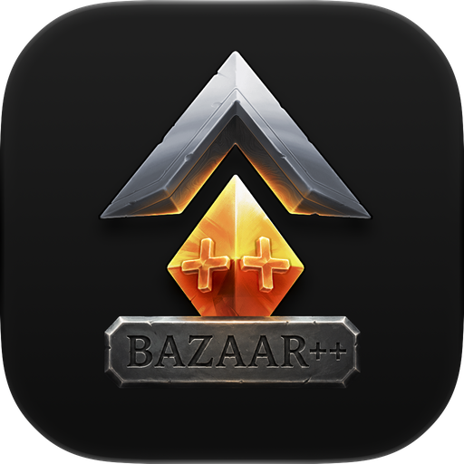

<div align="center">



# BazaarPlusPlus

**Born of Passion** · An in-game mod for [_The Bazaar_](https://www.playthebazaar.com) on Windows, macOS, and Android

[中文](README.md) · [Website](https://bazaarplusplus.com) · [Download](https://bazaarplusplus.com/download?lang=en) · [Tutorial](https://bazaarplusplus.com/tutorial?lang=en) · [Release Notes](https://github.com/BazaarPlusPlus/BazaarPlusPlus/releases) · [Ko-fi](https://ko-fi.com/cauyxy)

[](https://bazaarplusplus.com)
[](LICENSE)
[](https://bazaarplusplus.com/download)
[](https://github.com/BepInEx/BepInEx)
[](https://github.com/LavaGang/MelonLoader)
[](https://learn.microsoft.com/dotnet/)
[](https://tauri.app)
[](https://react.dev)

</div>

---

BazaarPlusPlus is an open-source project for _The Bazaar_. It leaves game balance alone and adds information and records: a card collection browser, ten-win build recommendations, run history with combat replays, enchant and upgrade previews, a combat status bar, and more. On the desktop (Windows, macOS) it is a BepInEx mod plus a desktop installer; on Android it is the game APK with BazaarPlusPlus injected, installed directly. This repository also holds the upload backend, the data analyzer, and the public website.

Most players should get the installer or APK from [bazaarplusplus.com/download](https://bazaarplusplus.com/download?lang=en); this repository is for developers who want to inspect the implementation, contribute changes, or build locally.

> [!NOTE]
> The bulk of the codebase is led by [Codex](https://openai.com/codex), with [Claude Code](https://claude.com/product/claude-code) contributing in collaboration.

## Quick Start

### Windows and macOS

1. Open [bazaarplusplus.com/download](https://bazaarplusplus.com/download?lang=en) and choose the Windows `.exe` or macOS `.dmg`.
2. Close the game before running the installer. For updates, uninstall the old build before installing the new one.
3. Launch _The Bazaar_ once after installation so BazaarPlusPlus can finish setup.
4. On the main menu, confirm that the **Card Collection** button appears and the footer version text includes `BPP version`.

The desktop installer also provides repair, uninstall, data reset, and local history cleanup, and can update itself. Compatible mod updates download in game and take effect after restarting. Every desktop release also provides a complete installer with that version of the mod; if in-game updating cannot connect, download the installer and update manually.

After upgrading from 5.x, one click on the installer's Install page imports your old runs, screenshots, and replays into the new 6.0 data folder; imported runs stay local and are never uploaded, the old folder is left unchanged, and you can delete it from the installer later.

### Android

1. Download the `.apk` (arm64) from the Android card on the [download page](https://bazaarplusplus.com/download?lang=en). The Android build is experimental; report problems in QQ group 1083470305.
2. Uninstall the official _The Bazaar_ first: Android will not install over an app signed by someone else. Your account and progress stay on the server; you only need to sign in again.
3. Install the downloaded APK and sign in. BazaarPlusPlus settings live in the game's own Settings dialog.
4. When the game updates, download the new APK and install it over this one; no uninstall needed. When only the mod changes, it updates itself in game.

## Feature Matrix

Desktop includes Windows and macOS. ✅ supported　◐ partial　— not available

| Feature                                               | Desktop |            Android            |
| ----------------------------------------------------- | :-----: | :---------------------------: |
| Card collection and ten-win build recommendations     |   ✅    |              ✅               |
| Run history, favorites, and notes                     |   ✅    |              ✅               |
| Combat replays and Ghost Battles                      |   ✅    |              ✅               |
| Combat status bar and speed controls                  |   ✅    |              ✅               |
| Enchant, upgrade, and detailed previews               |   ✅    | ◐ controls and content differ |
| Replay recording and automatic end-of-run screenshots |   ✅    |               —               |
| OBS stream overlay                                    |   ✅    |               —               |

Desktop also offers monster board previews, combat impact, bilingual item names, voice subtitles, and other display aids, plus FSR upscaling and optional BazaarDB screenshot uploads (off by default). All platforms support Mainland Simplified and Taiwan Traditional Chinese terminology.

All platforms upload run and replay data in the background while outside a run, powering Ghost Battles and the website's [hero statistics](https://bazaarplusplus.com/heroes?lang=en).

See the [tutorial](https://bazaarplusplus.com/tutorial?lang=en) for the full feature list, platform differences, and instructions.

## Repository Layout

| Directory                            | Contents                                                                     |
| ------------------------------------ | ---------------------------------------------------------------------------- |
| `bazaarplusplus-mod/`                | The in-game mod: shared Core, desktop BepInEx Host, Android MelonLoader Host |
| `bazaarplusplus-installer/`          | The desktop installer (Tauri 2 + React)                                      |
| `bazaarplusplus-server/`             | Cloudflare Worker: Bundle upload, Ghost discovery, and BazaarDB delivery     |
| `bazaarplusplus-analyzer/`           | Turns Bundles into hero and build snapshots                                  |
| `bazaarplusplus-site/`               | bazaarplusplus.com                                                           |
| `bazaarplusplus-ios/`                | iOS App: runs the game's Mac build on iPhone/iPad with the mod (interim)     |
| `design/`                            | Design tokens, shared styles, and the brand book                             |
| `VERSION`, `release.mjs`, `release/` | Product version and the release pipeline for all three platforms             |

Each project keeps its own toolchain, `README.md`, and `AGENTS.md`; the root [`AGENTS.md`](AGENTS.md) records cross-project conventions and contract owners.

## Building From Source

Install the toolchains listed in the [development guide](docs/development.md) (just, .NET, Node, Rust, Python/uv), then:

```bash
just setup                  # Shared local config, locked dependencies, Git hooks
just doctor                 # What is still missing on this machine
just mod::fetch macos online  # Game assemblies for the mod (Windows: windows)
just mod::fetch android online  # Interop Snapshot and loader for the Android Host
just                        # Every command, grouped by project
```

The mod compiles against the game assemblies pinned by the Snapshot Lock `bazaarplusplus-mod/build/game-libs.lock.json`: `mod::fetch` accepts a local Steam install of _The Bazaar_ at the locked game version and otherwise pulls the snapshot from private storage; details are in the [development guide](docs/development.md#游戏程序集) (Chinese). Gate one project with `just <project>::check` and `just <project>::test`; `just fmt` formats every project. `just mod::build` only compiles; deploy a development DLL into the game explicitly with `just mod::build --deploy`. The Android Host builds with `just mod::android-build` and goes to a connected device with `just mod::android-deploy`; device smoke tests are in the [development guide](docs/development.md#android-冒烟) (Chinese).

Release builds (desktop installers and the Android APK) are compiled, signed, and uploaded by the `release.yml` GitHub Actions workflow on hosted runners; the signing, notarization, Android release key, and R2 credentials exist only as GitHub secrets and in the maintainers' local configuration, never in the public repository. Game assembly snapshots, decompiled game output, `.env`, and `.dev.vars` are not in the tree either. The release flow is in the [product release guide](docs/release.md) (Chinese).

## Derivative Work Notice

> [!IMPORTANT]
> If you plan to build on top of this project or release derivative mods, make sure your work complies with _The Bazaar_ official [Mod Policy](https://www.playthebazaar.com/mod-policy).

## Acknowledgements

|                          |                                                                                                                                                                                                                                                                                                                       |
| ------------------------ | --------------------------------------------------------------------------------------------------------------------------------------------------------------------------------------------------------------------------------------------------------------------------------------------------------------------- |
| **Inspiration**          | [BazaarHelper](https://github.com/Duangi/BazaarHelper) · [BazaarPlannerMod](https://github.com/oceanseth/BazaarPlannerMod)                                                                                                                                                                                            |
| **Data reference**       | [bazaardb.gg](https://bazaardb.gg)                                                                                                                                                                                                                                                                                    |
| **Runtime dependencies** | [BepInEx](https://github.com/BepInEx/BepInEx) · [MelonLoader](https://github.com/LavaGang/MelonLoader) · [Harmony](https://github.com/pardeike/Harmony) · [Tauri](https://tauri.app) · [React](https://react.dev) · [Vite](https://vite.dev) · [Tailwind CSS](https://tailwindcss.com) · [FFmpeg](https://ffmpeg.org) |
| **Co-creators**          | [Codex](https://openai.com/codex) · [Claude Code](https://claude.com/product/claude-code)                                                                                                                                                                                                                             |

## Supporters

Thanks to everyone who supports BazaarPlusPlus. The full supporter list lives at [bazaarplusplus.com/support](https://bazaarplusplus.com/support?lang=en).

If you would like to support continued maintenance, head to [Ko-fi](https://ko-fi.com/cauyxy) or check the in-app sponsor options.

## License

Released under the [MIT License](LICENSE).

---

<div align="center">


**BazaarPlusPlus** · Born of Passion

[Website](https://bazaarplusplus.com) · [Download](https://bazaarplusplus.com/download?lang=en) · [Tutorial](https://bazaarplusplus.com/tutorial?lang=en) · [Ko-fi](https://ko-fi.com/cauyxy)

<sub>Archived history: [mod](https://github.com/BazaarPlusPlus/bazaarplusplus-mod) · [installer](https://github.com/BazaarPlusPlus/bazaarplusplus-installer) · [server](https://github.com/BazaarPlusPlus/bazaarplusplus-server) · [analyzer](https://github.com/BazaarPlusPlus/bazaarplusplus-analyzer) · [site](https://github.com/BazaarPlusPlus/bazaarplusplus-site)</sub>

</div>
