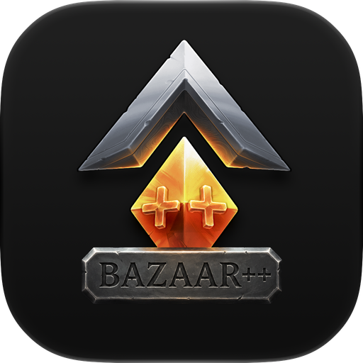

<div align="center">



# BazaarPlusPlus

**Born of Passion** · An in-game mod for [_The Bazaar_](https://www.playthebazaar.com) on Windows, macOS, and Android

[中文](README.md) · [Website](https://bazaarplusplus.com) · [Download](https://bazaarplusplus.com/download?lang=en) · [Tutorial](https://bazaarplusplus.com/tutorial?lang=en) · [Release Notes](https://github.com/BazaarPlusPlus/BazaarPlusPlus/releases) · [Ko-fi](https://ko-fi.com/cauyxy)

[](https://bazaarplusplus.com)
[](LICENSE)
[](https://bazaarplusplus.com/download?lang=en)

</div>

---

BazaarPlusPlus leaves game balance alone and adds information and records: a card collection browser, ten-win build recommendations, run history with combat replays, enchant and upgrade previews, a combat status bar, and more.

> [!NOTE]
> The bulk of the codebase is led by [Codex](https://openai.com/codex), with [Claude Code](https://claude.com/product/claude-code) contributing in collaboration.

## Download and Install

Get the package for your platform from the [download page](https://bazaarplusplus.com/download?lang=en); step-by-step instructions are in the [tutorial](https://bazaarplusplus.com/tutorial?lang=en).

- **Windows / macOS**: close the game, run the installer, then launch the game once. The **Card Collection** button on the main menu means it worked. The installer also repairs, uninstalls, and updates.
- **Android (experimental)**: install the official _The Bazaar_ first, then the BazaarPlusPlus APK (arm64, Android 11+), and start the game from BazaarPlusPlus. Feedback: QQ group 1083470305.

## Features

Desktop includes Windows and macOS. ✅ supported　◐ partial　— not available

| Feature                                           | Desktop |            Android             |
| ------------------------------------------------- | :-----: | :----------------------------: |
| Card collection and ten-win build recommendations |   ✅    |               ✅               |
| Run history, favorites, and notes                 |   ✅    |               ✅               |
| Combat replays and Ghost Battles                  |   ✅    |               ✅               |
| Combat status bar and speed controls              |   ✅    |               ✅               |
| Enchant, upgrade, and detailed previews           |   ✅    | ◐ controls and content differ  |
| Replay recording                                  |   ✅    |               —                |
| Automatic end-of-run screenshots                  |   ✅    | ◐ only with BazaarDB upload on |
| OBS stream overlay                                |   ✅    |               —                |

All platforms upload run and replay data in the background while outside a run, powering Ghost Battles and the website's [hero statistics](https://bazaarplusplus.com/heroes?lang=en). Battle data with account IDs and display names removed may also be kept longer and used for analysis and research. A player who binds a BPP Account can view their own ranked runs uploaded in the last 8 days on the website; these are the same run data, not a separate copy, and they expire with it. See the [tutorial](https://bazaarplusplus.com/tutorial?lang=en) for the full feature list and platform differences.

## Development

| Directory                   | Contents                                                                     |
| --------------------------- | ---------------------------------------------------------------------------- |
| `bazaarplusplus-mod/`       | The in-game mod: shared Core, desktop BepInEx Host, Android MelonLoader Host |
| `bazaarplusplus-installer/` | The desktop installer (Tauri 2 + React)                                      |
| `bazaarplusplus-android/`   | The Android app: launches the official game and loads the mod                |
| `bazaarplusplus-server/`    | Cloudflare Worker: Bundle upload, Ghost discovery, and BazaarDB delivery     |
| `bazaarplusplus-bot/`       | QQ commands, account bindings, and player report images                      |
| `bazaarplusplus-analyzer/`  | Turns Bundles into hero and build snapshots                                  |
| `bazaarplusplus-ui-docs/`   | [UI kit documentation](https://ui.bazaarplusplus.com)                        |
| `bazaarplusplus-site/`      | bazaarplusplus.com                                                           |
| `packages/ui/`              | Standalone React 19 + Tailwind 4 UI kit (`@bazaarplusplus/ui`)               |
| `packages/runs/`            | Shared internal run message stream and decision projection (`@bpp/runs`)     |
| `design/`                   | Cross-platform design tokens, brand mark, and guidelines                     |
| `VERSION`, `release/`       | Product version and the release pipeline                                     |

```bash
just setup    # Local config, locked dependencies, Git hooks
just doctor   # What is still missing on this machine
just          # Every command, grouped by project
```

Toolchains, game assemblies, and Android smoke tests are in the [development guide](docs/development.md); releases are in the [product release guide](docs/release.md) (both in Chinese); cross-project conventions are in [`AGENTS.md`](AGENTS.md). Each project directory has its own `README.md`.

> [!IMPORTANT]
> If you build on top of this project, follow _The Bazaar_ official [Mod Policy](https://www.playthebazaar.com/mod-policy).

## Acknowledgements

Inspired by [BazaarHelper](https://github.com/Duangi/BazaarHelper) and [BazaarPlannerMod](https://github.com/oceanseth/BazaarPlannerMod); data reference [bazaardb.gg](https://bazaardb.gg); built on [BepInEx](https://github.com/BepInEx/BepInEx), [MelonLoader](https://github.com/LavaGang/MelonLoader), [Harmony](https://github.com/pardeike/Harmony), [Tauri](https://tauri.app), [FFmpeg](https://ffmpeg.org), and more.

Thanks to all our [supporters](https://bazaarplusplus.com/support?lang=en). To support continued maintenance, head to [Ko-fi](https://ko-fi.com/cauyxy).

## License

[MIT License](LICENSE)
