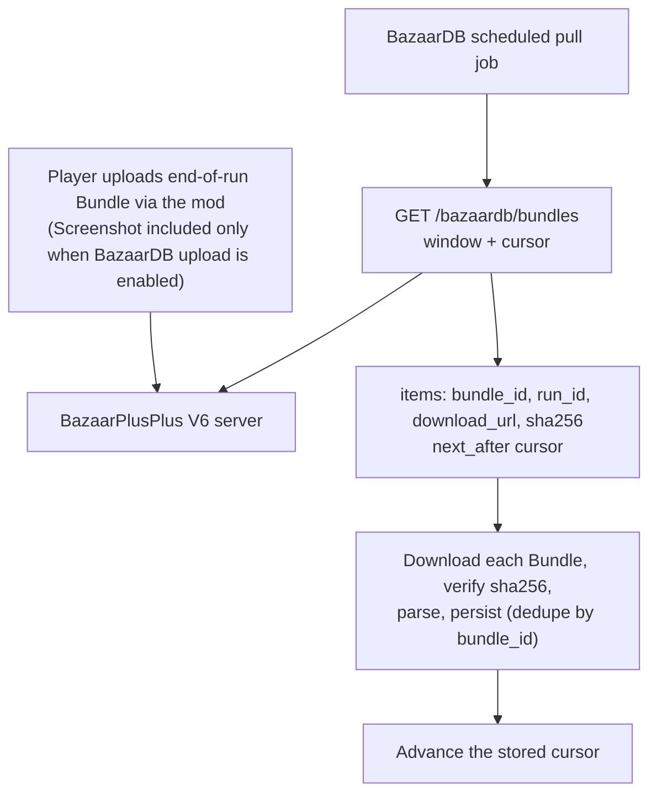

# BazaarPlusPlus × BazaarDB Integration (V6)

Last updated: 2026-10-30

This document is the integration contract between BazaarPlusPlus V6 and BazaarDB. It replaces the V5 `claim`/`settle` integration. BazaarPlusPlus 6.0.0 shipped on 2026-10-29: Screenshot-bearing Bundles from 6.0 players reach BazaarDB only through the V6 API described here. A summary of changes from V5 is at the end of this document.

## Overview

The model stays pull-based: **players upload end-of-run Bundles to the BazaarPlusPlus server through the mod, and BazaarDB pulls them from the BazaarPlusPlus server.**

What changes is who keeps delivery state. V6 has no delivery queue. BazaarDB pages a read-only feed of Screenshot-bearing Bundles ordered by server availability time, and stores its own cursor. There is no claim, lease, settle, attempt counter, or failed state on the BazaarPlusPlus side.

The delivery unit is still the **Bundle**: an immutable binary container holding one Run and, for every Bundle in this feed, one end-of-run Screenshot. The mod includes the Screenshot only while the player has BazaarDB upload enabled, and only Screenshot-bearing Bundles appear in the feed.

Every Bundle in the feed has passed structural validation (container prefix, manifest schema, and per-segment digests) at upload.

## Data Flow



## API

Base URL:

```text
https://mod-api-v6.bazaarplusplus.com
```

Authentication uses a new V6 delivery token, sent separately by BazaarPlusPlus. The V5 token does not work on V6.

```http
Authorization: Bearer <V6 token provided by BazaarPlusPlus>
```

A missing or unknown token returns `401 unauthorized`; a BazaarPlusPlus token for another service scope returns `403 insufficient_scope`.

All errors use the same envelope as V5:

```json
{
  "error": {
    "code": "invalid_query",
    "message": "Diagnostic text",
    "retryable": false,
    "request_id": "request-id",
    "details": { "field": "available_from_ms" }
  }
}
```

Match on the HTTP status, `code`, and `retryable`; do not match on `message`. `details` is optional. Every response carries an `X-Request-Id` header; include it when you report a problem.

An OpenAPI 3.1 document is served at [`/openapi.json`](https://mod-api-v6.bazaarplusplus.com/openapi.json), with an interactive reference at [`/docs`](https://mod-api-v6.bazaarplusplus.com/docs).

### `GET /bazaardb/bundles`

Lists Screenshot-bearing Bundles whose availability time is inside a fixed half-open window, oldest first.

```http
GET /bazaardb/bundles?available_from_ms=1785628800000&available_before_ms=1785632400000&limit=200
Authorization: Bearer <token>
```

Query parameters:

| Parameter | Required | Rules |
|---|---|---|
| `available_from_ms` | Yes | Inclusive window start, Unix ms. Must be no earlier than server time minus 8 days |
| `available_before_ms` | No | Exclusive window end, Unix ms. Defaults to server time minus 60 seconds (the settle point); may not be later than the settle point |
| `limit` | No | Default 200; range 1–500 |
| `after_available_at_ms` | With `after_bundle_id` | Keyset cursor: `next_after.available_at_ms` from the previous page. Must be inside the window |
| `after_bundle_id` | With `after_available_at_ms` | Keyset cursor: `next_after.bundle_id` from the previous page |

Each parameter may appear once. Unknown parameters are rejected. `available_from_ms` must be less than `available_before_ms`.

Response `200`:

```json
{
  "window": {
    "available_from_ms": 1785628800000,
    "available_before_ms": 1785632400000
  },
  "items": [
    {
      "bundle_id": "01J00000000000000000000001",
      "available_at_ms": 1785629000000,
      "run_id": "run-id",
      "content_type": "application/x-bpp-bundle-v6",
      "sha256": "64-lowercase-hex-characters",
      "download_url": "https://bazaarplusplus-bundle-v6.<ACCOUNT_ID>.r2.cloudflarestorage.com/bundles/...bundle?X-Amz-Expires=604800&...",
      "download_expires_at_ms": 1786233800000
    }
  ],
  "next_after": {
    "available_at_ms": 1785629000000,
    "bundle_id": "01J00000000000000000000001"
  }
}
```

Notes:

- `window` echoes the window the server used. When you omit `available_before_ms`, read the resolved end from `window.available_before_ms`, and send it explicitly on every later page of the same window.
- Items sort by `available_at_ms ASC, bundle_id ASC`. `next_after` is `null` on the last page of the window.
- `available_at_ms` is the server time at which the Bundle was committed. It is not the player's clock and not the Run's time.
- A window that ends at or before the settle point is final: no Bundle is added to it later. Paging the same window again returns the same items, with newly signed URLs.
- `sha256` is the digest of the complete Bundle. Verify the downloaded bytes against it before parsing.
- `download_url` is a presigned S3 `GET` URL, valid for 7 days. Download directly from it; the BazaarPlusPlus server does not proxy downloads. Treat it as a bearer capability and do not log it.
- Run-only Bundles never appear in this feed.

### Errors

| Status | Code | Meaning | Recommended action |
|---:|---|---|---|
| 400 | `invalid_query` | Malformed or unknown parameter, bad cursor, or empty window | Fix the request |
| 400 | `window_not_settled` | `available_before_ms` is later than server time minus 60 seconds | Use a smaller end, or omit it |
| 401 | `unauthorized` | Missing or unknown token | Check the credential |
| 403 | `insufficient_scope` | Token for another service | Use the BazaarDB token |
| 410 | `window_expired` | `available_from_ms` is earlier than server time minus 8 days | Bundles before the 8-day line are gone; restart from inside the window and report the gap |
| 500 | `internal_error` | Server configuration error | Retry with backoff; report `request_id` |
| 503 | `storage_unavailable` | Temporary storage or signing failure | Retry with exponential backoff |

## Recommended Pull Job

Run the job every 1–5 minutes. BazaarDB keeps one stored value: `cursor_ms`, the end of the last fully processed window.

1. Start a round with `from = cursor_ms`. Call `GET /bazaardb/bundles?available_from_ms=<from>&limit=500`, without `available_before_ms`. Keep `window.available_before_ms` from the response as `before`.
2. For each item: download `download_url`, verify the bytes against `sha256`, parse the Bundle, and persist it, deduplicating by `bundle_id`.
3. While `next_after` is not `null`, request the next page with the same `available_from_ms`, `available_before_ms=<before>`, and `after_available_at_ms` / `after_bundle_id` from `next_after`. Repeat step 2.
4. When `next_after` is `null` and every item is persisted, store `cursor_ms = before`. This ends the round.
5. If the round fails part-way, do not advance `cursor_ms`. The next round repeats the same window; deduplication by `bundle_id` absorbs the repeats.
6. If a single Bundle cannot be accepted (bad digest, parse error), record it on your side and continue. The server does not track per-Bundle outcomes; retrying is your choice, inside the 8-day window.

First run: set `cursor_ms` to any time within the last 8 days. BazaarPlusPlus 6.0.0 shipped on 2026-10-29, so the oldest V6 Bundles start then.

Monitor `now − cursor_ms`. The server cannot see your progress. If the lag reaches 8 days, older Bundles are deleted and the server answers `410 window_expired`.

Delivery is at-least-once from your point of view: deduplicate by `bundle_id`. Each Bundle holds exactly one Run, so `run_id` is an equivalent key.

## Bundle Wire Format

Content type: `application/x-bpp-bundle-v6`.

```text
[16-byte prefix][manifest JSON][Run segment][Screenshot segment]
```

The layout is the same as V5. Only the version values change.

### Prefix

Unsigned big-endian integers:

| Offset | Bytes | Value |
|---:|---:|---|
| 0 | 8 | ASCII `BPPBNDL6` |
| 8 | 4 | Bundle version `6` |
| 12 | 4 | UTF-8 manifest JSON byte length |

Segment offsets in the manifest are relative to the first byte after the manifest. The Run starts at offset `0`; the Screenshot starts at the Run length. Segments are contiguous, with no gaps, overlap, or trailing bytes. Reject any other magic or version.

Digests, all lowercase SHA-256 hex:

- the feed item's `sha256` covers the complete downloaded bytes;
- each segment `sha256` in the manifest covers that segment alone.

### Manifest

The full JSON Schema is [`contracts/v6/manifest.schema.json`](https://github.com/BazaarPlusPlus/BazaarPlusPlus/blob/master/bazaarplusplus-server/contracts/v6/manifest.schema.json). Every time is a Unix millisecond integer.

| Field | Type | Notes |
|---|---|---|
| `bundle_id` | string | Uppercase ULID (26 chars); the dedup key |
| `bundle_version` | integer | Always `6` |
| `created_at_ms` | integer | Client time |
| `run.run_id` | string | Identifier |
| `run.player_account_id` | string | The uploading player's in-game account ID |
| `run.run_format_version` | integer | Always `6` |
| `run.projection.run` | object | Reserved; treat as opaque |
| `run.projection.battles` | array | 0–30 battle summaries, unique `battle_id` |
| `run.payload` | object | `offset` `0`, `length` 1–2,097,151, `sha256`, `content_type` `application/x-bpp-run-v6` |
| `screenshot` | object | Always present in this feed. `offset`, `length` (1–1,048,576), `sha256`, `content_type` (`image/jpeg` or `image/webp`), `width`, `height`, `quality` (1–100), `captured_at_ms` |

Each battle carries `battle_id`, `recorded_at_ms`, `day`, `hour`, `encounter_id`, `combat_kind`, `result`, `winner_combatant_id`, `loser_combatant_id`, `is_final_battle`, and `player` / `opponent` combatants. A combatant carries `account_id`, `display_name`, `hero_id`, `hero_name`, `rank`, `rating`, `level`, `prestige`, and `victories`; nullable fields are present as a value or `null`.

Identifier fields use 1–128 characters from letters, digits, `.`, `_`, `:`, and `-`, and start with a letter or digit.

Ignore unknown manifest fields. Fields may be added without notice; breaking changes are announced in advance.

### Run segment

`application/x-bpp-run-v6` is a gzip stream holding one MessagePack object. Its contract is [`run-payload-v6.md`](https://github.com/BazaarPlusPlus/BazaarPlusPlus/blob/master/bazaarplusplus-mod/docs/contracts/run-payload-v6.md). If you decode it, check that its `RunId` and `PlayerAccountId` equal the manifest's `run.run_id` and `run.player_account_id`, and quarantine the Bundle if they do not. BazaarDB may ignore the Run segment if it needs only the Screenshot and the manifest summary.

### Reading guidance

- The end-of-run image is the Screenshot segment. The manifest's `screenshot` entry gives its offset, length, type, dimensions, and digest.
- The player identity and run summary are in the manifest: `run.player_account_id` and the per-battle `player` blocks. The battle with `is_final_battle: true` reflects the end-of-run state.

## Data Handling

- Screenshot delivery is opt-in: the mod includes the Screenshot only while the player has BazaarDB upload enabled.
- The feed exposes only the Bundle contents described above: the player identity as shown in game, the structured Run, and the end-of-run image.
- Bundles are kept for **8 days** from upload, then removed by a storage lifecycle rule. Reading a Bundle does not delete it.
- Bundle metadata is deleted **15 days** after upload. Keep your own deduplication records for as long as you need them.

## Changes from the V5 Integration

- **Base URL and token**: `mod-api-v5.bazaarplusplus.com` → `mod-api-v6.bazaarplusplus.com`, with a new token. The V5 server receives no Bundles from 6.0 players.
- **Endpoints**: `POST /bazaardb/deliveries/claim` and `POST /bazaardb/deliveries/settle` → one `GET /bazaardb/bundles`. Nothing is sent back to BazaarPlusPlus.
- **State**: the lease, 3-attempt cap, retry backoff, `permanent_failure`, and the terminal `failed` state are gone. BazaarDB owns its cursor, retries, and deduplication. A Bundle stays available for the full 8 days whatever happens on your side.
- **Batching**: `limit` default 50 → 200, maximum 50 → 500. Items keep `bundle_id`, `run_id`, `download_url`, `download_expires_at_ms`, `content_type`, and `sha256`, and add `available_at_ms`. There is no settle deadline.
- **Data loss signal**: `bundle_expired` / `delivery_attempts_exhausted` → `410 window_expired` when the cursor is older than 8 days.
- **Bundle**: magic `BPPBNDL5` → `BPPBNDL6`, version `5` → `6`, content type `application/x-bpp-bundle-v6`, `run_format_version` `6`, Run content type `application/x-bpp-run-v6`.
- **Manifest**: `winner_combatant_id` and `loser_combatant_id` are no longer nullable; both are identifiers. All other fields are unchanged.
- **Unchanged**: the prefix and segment layout, digest rules, Screenshot fields, 7-day presigned URLs, 8-day Bundle retention, 15-day metadata retention, and the error envelope.
